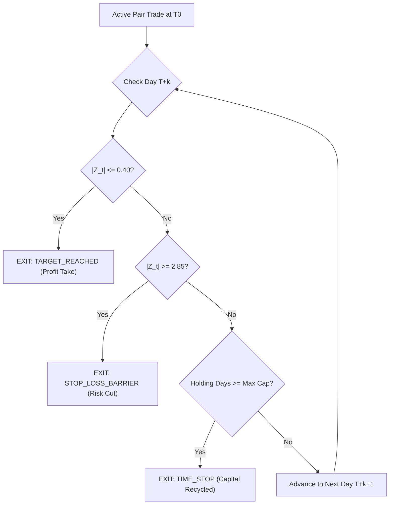

# Institutional Cointegrated Pairs Trading Strategy v4
## Quantitative Trade Extraction, Dual-Stock Feature Pipeline, ML Training & UI Integration Plan

---

### Executive Overview & Objectives
This engineering document specifies the end-to-end design, exact mathematical formulations, operational constraints, machine learning architecture, validation procedures, and dashboard reporting for the **Cointegrated Stat-Arb Pairs Trading Strategy v4**.

The strategy targets mean-reverting intra-sector equity pairs across a 5-year historical dataset (`2021-08-17` to `2026-11-19`), strictly partitioning data into **4 years of training** (`2021-08-17` to `2025-11-18`) and **1 year of out-of-sample holdout testing** (`2025-11-19` to `2026-11-19`).

---

## 1. System Architecture & Directory Layout

All generated data assets, feature sets, models, and evaluation reports are stored within dedicated directories:

```text
d:\Master_Folder\vectorTrade/
├── pair_strategy_v4_config.json              # Core institutional parameter specification
├── data_store/
│   ├── curated_pairs.json                    # 156 screened intra-sector pairs
│   └── pair_strategy/                        # Dedicated strategy data repository
│       ├── raw_pair_series/                  # Time-aligned dual-stock daily series
│       ├── pair_trades_all.csv               # Complete trade universe with dual-stock + 7-day data
│       ├── pair_trades_train.csv             # 4-Year training partition (<= 2025-11-18)
│       ├── pair_trades_test.csv              # 1-Year holdout evaluation partition (> 2025-11-18)
│       ├── pair_trades_metadata.json         # Summary statistics, holding periods, win rates
│       └── forward_7d_trajectories.json      # 7-day forward path verification cache
├── models/
│   ├── pair_trading_quality_classifier.pkl   # Trained ML Quality Classifier (XGBoost)
│   ├── pair_trading_scaler.pkl               # RobustScaler pipeline
│   ├── pair_trading_imputer.pkl              # Median Imputer
│   ├── pair_trading_features.txt             # Ranked list of input feature names
│   └── pair_trading_model_metrics.json       # OOS accuracy, precision, recall, confusion matrix
├── offline/
│   ├── pair_trade_engine.py                  # Core trade finder, spread generator, and labeler
│   ├── pair_model_trainer.py                 # 4Y vs 1Y model training & cross-validation script
│   └── templates/strategies.html             # Enhanced dashboard with model metrics and backtests
├── online/
│   ├── services/pair_inference_service.py    # Real-time daily pair evaluation service
│   └── templates/strategies.html             # Online production strategies dashboard
└── tests/
    ├── test_pair_trade_engine.py             # Unit tests for trade generation & forward windows
    ├── test_pair_model_inference.py          # Unit tests for model loading & feature alignment
    └── test_pair_ui_integration.py           # Unit tests for dashboard render & API endpoints
```

---

## 2. Phase 1: Dual-Stock Feature Engineering & Config-Driven Trade Extraction

### 2.1 Universe & Timeframe
- **Source Universe**: 156 intra-sector pairs identified in `data_store/curated_pairs.json`.
- **Constituents**: Read from `5_year_data/raw/{SYMBOL}_data.csv`.
- **Date Range**: `2021-08-17` through `2026-11-19` (~1,305 trading sessions).

### 2.2 Mathematical Formulations

#### 1. Dynamic OLS Hedge Ratio ($\beta$)
For each pair of stocks $(A, B)$ sharing the same sector, estimate the hedge ratio $\beta$ using Ordinary Least Squares over a rolling 90-day lookback window $N = 90$ (`divergence_triggers.lookback_days`):

$$\ln(P_{A, t}) = \alpha_t + \beta_t \cdot \ln(P_{B, t}) + \epsilon_t$$

$$\beta_t = \frac{\text{Cov}(\ln(P_{A, [t-N+1:t]}), \ln(P_{B, [t-N+1:t]}))}{\text{Var}(\ln(P_{B, [t-N+1:t]}))}$$

#### 2. Rolling Log-Price Spread
$$\text{Spread}_t = \ln(P_{A, t}) - \beta_t \cdot \ln(P_{B, t})$$

#### 3. Rolling Normalized Spread $Z$-Score
Using the 90-day sample mean $\mu_{\text{Spread}, t}$ and sample standard deviation $\sigma_{\text{Spread}, t}$:

$$Z_t = \frac{\text{Spread}_t - \mu_{\text{Spread}, t}}{\sigma_{\text{Spread}, t}}$$

#### 4. Momentum Velocity Flattening Filter
Divergence exhaustion must be confirmed before entering to prevent catching falling knives:

$$\Delta Z_t = Z_t - Z_{t-1}$$

Trade entry requires:
$$|\Delta Z_t| \le 0.05 \quad (\text{config: } \texttt{"max\_entry\_momentum\_slope": 0.05})$$

#### 5. Entry Conditions
- **Long Pair Spread (BUY A, SHORT B)**:
  $$-3.00 \le Z_t \le -2.10 \quad \text{AND} \quad |\Delta Z_t| \le 0.05$$
- **Short Pair Spread (SHORT A, BUY B)**:
  $$+2.10 \le Z_t \le +3.00 \quad \text{AND} \quad |\Delta Z_t| \le 0.05$$
- **Extreme Blowout Barrier**:
  If $|Z_t| > 3.00$, the pair is considered in structural divergence regime and entry is rejected (`"spread_volatility_tiers.blowout_penalty_z_sigma": 3.0`).

### 2.3 Comprehensive Dual-Stock & Spread Feature Set
At every entry timestamp $T_0$, compute and record features across both constituents and the spread:

| Feature Category | Stock A Features | Stock B Features | Pair Spread Features |
| :--- | :--- | :--- | :--- |
| **Trend / Moving Avg** | `SMA_20_Ratio_A`, `SMA_50_Ratio_A`, `SMA_200_Ratio_A` | `SMA_20_Ratio_B`, `SMA_50_Ratio_B`, `SMA_200_Ratio_B` | `Spread_SMA_20_Dev`, `Spread_SMA_50_Dev` |
| **Oscillators** | `RSI_14_A`, `MACD_Hist_A` | `RSI_14_B`, `MACD_Hist_B` | `RSI_Diff_A_minus_B`, `Z_Score_Entry` |
| **Volatility / Range** | `ATR_14_Pct_A`, `HistVol_20_A` | `ATR_14_Pct_B`, `HistVol_20_B` | `Spread_Vol_Pct_90`, `Vol_Ratio_A_to_B` |
| **Statistical Dynamics** | `Volume_Ratio_20_A` | `Volume_Ratio_20_B` | `Rolling_Corr_90`, `Hedge_Ratio_Beta`, `ADF_Stat_90`, `Half_Life_Days` |

### 2.4 Mandatory 7-Day Forward Horizon Tracking
For every trade signal generated on day $T_0$, capture forward trajectories across $T+1, T+2, \dots, T+7$:
- `P_A[T+k]`, `P_B[T+k]` (Closing prices for both legs).
- `Spread[T+k]` and `Z_Score[T+k]` for $k \in \{1, 2, 3, 4, 5, 6, 7\}$.
- Cumulative pair return at each forward bar $k$.

---

## 3. Phase 2: Dynamic Stop-Loss, Target Resolution & Outcome Labeling

### 3.1 Exit Mechanics & Priority Rules
Every active pair position is monitored sequentially from $T+1$ forward until one of three terminal conditions is satisfied:



#### 1. Mean-Reversion Target Exit
- Trigger: $|Z_t| \le 0.40$ (`"z_score_exit_target": 0.40`).
- Execution: Positions closed at market close on the day $Z$ normalizes.

#### 2. Dynamic Sigma Stop-Loss Barrier
- Trigger: $|Z_t| \ge 2.85$ (`"z_score_stop_loss_barrier": 2.85`).
- Execution: Position liquidated immediately upon spread breakdown.

#### 3. Half-Life Time Stop & Maximum Holding Cap
The Ornstein-Uhlenbeck mean-reversion speed parameter $\theta$ is estimated via discrete autoregression:

$$\Delta \text{Spread}_t = \mu_e + \theta \cdot \text{Spread}_{t-1} + \epsilon_t$$

$$\tau_{HL} = -\frac{\ln(2)}{\theta}$$

The dynamic time-stop limit is defined as:

$$T_{\text{max}} = \text{clamp}\left(\lfloor 2.5 \times \tau_{HL} \rfloor, \, 4, \, 22\right)$$

*(Derived from `"half_life_time_stop_multiplier": 2.5`, `"min_holding_days_floor": 4`, `"max_holding_days_cap": 22"`)*.

### 3.2 Position Return & Trade Outcome Labeling

#### Net Pair Return Formulation:
$$\text{Return}_{\text{Pair}} = \text{Direction} \cdot \left[ \left(\frac{P_{A, \text{exit}} - P_{A, \text{entry}}}{P_{A, \text{entry}}}\right) - \beta \cdot \left(\frac{P_{B, \text{exit}} - P_{B, \text{entry}}}{P_{B, \text{entry}}}\right) \right]$$

Where $\text{Direction} = +1$ for Long Spread and $-1$ for Short Spread.

#### Three-Tier Target Classification:
1. **SUCCESS (`Label = 1`)**:
   - Exit by Target ($|Z_{\text{exit}}| \le 0.40$) **OR** Net Return $\ge +1.50\%$ without hitting stop barrier.
2. **FAIL (`Label = 0`)**:
   - Exit by Stop Barrier ($|Z_{\text{exit}}| \ge 2.85$) **OR** Net Return $< -1.00\%$.
3. **NEUTRAL (`Label = 2`)**:
   - Time stop triggered with flat consolidation ($-1.00\% \le \text{Return} < +1.50\%$).

### 3.3 Holding Time & Empirical Metric Logging
The engine calculates and logs:
- `Holding_Days`: Exact calendar and trading days in trade.
- `Avg_Holding_Time`: Aggregate mean duration across all trades.
- `Exit_Reason`: `TARGET`, `STOP_LOSS`, or `TIME_STOP`.
- `Max_Favorable_Excursion (MFE)` & `Max_Adverse_Excursion (MAE)`.

---

## 4. Phase 3: 4Y Train vs. 1Y Test Split & ML Model Architecture

### 4.1 Strict Temporal Split
To avoid data leakage, partitioning is strictly temporal:
- **Historical Training Window (4 Years)**:
  `2021-08-17` to `2025-11-18` (approx. 80% of data).
- **Out-of-Sample Holdout Testing Window (1 Year)**:
  `2025-11-19` to `2026-11-19` (last 1 year reserved strictly for testing).

### 4.2 Machine Learning Architecture
- **Model Type**: Extreme Gradient Boosting Classifier (`XGBClassifier`) with calibrated probability output.
- **Objective Function**: `binary:logistic` predicting $P(\text{Trade is Successful} \mid \text{Entry Features})$.
- **Preprocessing**:
  1. `SimpleImputer(strategy="median")`
  2. `RobustScaler(quantile_range=(5.0, 95.0))`
- **Hyperparameter Grid**:
  - `max_depth`: 4 to 6
  - `learning_rate`: 0.03
  - `n_estimators`: 250
  - `subsample`: 0.85
  - `colsample_bytree`: 0.80
  - `min_child_weight`: 3
- **Validation**:
  - Purged 5-Fold Grouped Time-Series Cross Validation on the 4-year training data.
  - Zero leakage across overlapping trade horizons.

### 4.3 Benchmark Evaluation Gates
The trained model must satisfy these institutional acceptance gates on the 1-year holdout set:
- **Win Rate**: $\ge 58.0\%$ (Benchmark from config).
- **Profit Factor**: $\ge 1.65$.
- **Max Drawdown**: $\le 24.0\%$.
- **Precision (Class 1)**: $\ge 62.0\%$.

---

## 5. Phase 4: Strategies UI Dashboard Integration & Daily Pipeline Hook

### 5.1 UI Dashboard Enhancements (`strategies.html`)
The existing Pair Trading interface under `/strategies` will be updated with:
1. **Interactive Model Diagnostics Subtab**:
   - Model accuracy, precision, recall, and ROC-AUC score cards.
   - Out-of-Sample Holdout Comparison: Strategy with ML Filter vs. Raw Rules.
   - Feature Importance ranking chart (identifying top predictive indicators like $\tau_{HL}$, $Z_{\text{Entry}}$, $\Delta Z$, RSI differential).
2. **Backtest & Empirical Trade Metrics Card**:
   - Total Trades Found (4Y Train vs 1Y Test).
   - Average Holding Time before target or stop.
   - Exit breakdown: % Target exits, % Barrier stops, % Time stops.
3. **Interactive Visual Pair Inspector Modal**:
   - Existing Base-100 Price Trajectory chart.
   - Existing Spread $Z$-Score chart with $\pm 2.10$ and $\pm 2.85$ bands.
   - **New**: Overlay of historical entry/exit trade markers and forward 7-day trajectories.

### 5.2 Daily Automation Integration
- In `run_headless_daily_pipeline.py`:
  - Include `PairInferenceService.evaluate_daily_pairs()` after stock feature generation.
  - Scan the 156 pairs using the latest closing prices.
  - Qualify setups meeting hurdle criteria and predicted $P(\text{Win}) \ge 0.60$.
  - Output qualified pair orders to MongoDB Atlas collection `pair_signals_watchlist`.
- In `time_monitor.py`:
  - Ensure daily execution triggers automatically at market close (4:00 PM).

---

## 6. Comprehensive Verification & Unit Testing Matrix

| Test Module | Test Case | Target Assertion |
| :--- | :--- | :--- |
| `test_pair_trade_engine.py` | `test_rolling_ols_and_zscore` | Hedge ratio $\beta > 0$, $Z$-score mean $\approx 0$, std $\approx 1$ over lookback |
| `test_pair_trade_engine.py` | `test_trade_entry_criteria` | Signals strictly satisfy $2.10 \le \|Z\| \le 3.00$ and $\|\Delta Z\| \le 0.05$ |
| `test_pair_trade_engine.py` | `test_7d_forward_horizon_data` | Forward dataset contains complete 7 bars for both Stock A and B |
| `test_pair_trade_engine.py` | `test_exit_resolution_rules` | Target exits occur when $\|Z\| \le 0.40$; barrier stop triggers at $2.85$ |
| `test_pair_trade_engine.py` | `test_holding_time_and_caps` | No trade exceeds max holding cap of 22 days |
| `test_pair_model_trainer.py`| `test_train_test_split_dates` | Train dates $\le 2025-11-18$, Test dates $> 2025-11-18$ (No overlap) |
| `test_pair_model_trainer.py`| `test_model_pipeline_artifacts`| Classifier, scaler, imputer, and feature text files exist on disk |
| `test_pair_model_trainer.py`| `test_model_inference_speed` | Inference latency $< 2$ ms per pair candidate |
| `test_pair_ui_integration.py`| `test_strategies_page_model_view`| `/strategies` renders pair model performance metrics and charts |
| `test_pair_ui_integration.py`| `test_api_pair_trades_endpoint` | `/api/pairs/trades` returns filtered trade history and forward paths |

---

## 7. Execution Constraints & Safeguards
1. **Workspace Boundary**: All edits are confined to `d:\Master_Folder\vectorTrade`. Never touch `NiftyML-Strategy`.
2. **Server Stability**: Never restart, reload, or kill existing running server processes.
3. **Data Integrity**: Never overwrite original raw CSVs in `5_year_data/raw/`. Write all computed pair metrics and trades to `data_store/pair_strategy/`.
4. **Reproducibility**: Set global random seed (`random_state=42`) across all cross-validation and XGBoost training runs.
