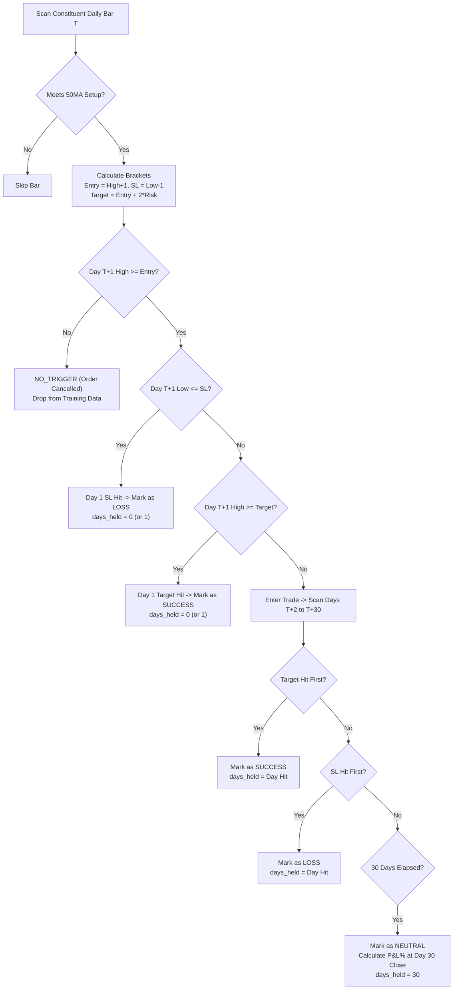
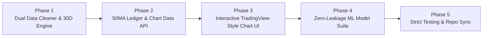

# VectorTrade - 50MA Strategy Architecture & Interactive Trade Visualizer Plan (Update 2)

**Document:** `docs/update_2.md`  
**Date:** 2026-11-03  
**Status:** PROPOSED (Awaiting User Approval)  
**Target Systems:** `NiftyML-Strategy` & `vectorTrade`

---

## 1. Executive Summary & Root Cause Analysis

### The Problem
During previous pipeline executions, the 50MA strategy in inference showed a **-600% loss**. This occurred because:
1. **Unfiltered Signal Aggregation:** Historical setups were analyzed without strictly enforcing the Day 1 entry trigger. Setups where the price never broke the `Buy Trigger` on Day 1 were erroneously treated as entered trades.
2. **Missing Multi-Day Forward Trajectory:** Trade outcomes were previously evaluated using approximate 7-day indicators rather than simulating the full day-by-day price path ($T+1$ through $T+30$) to detect whether Target or SL was hit first.
3. **Model Training on Mixed Data:** The strategy models were trained on generic signals rather than an isolated, rigorously labeled dataset of verified 50MA setups.

### The Solution: Update 2 Architecture
1. **Dual Dataset Generation in Step 3 (Data Cleaning):**
   - Retain `5_year_final_data_global.csv` for market-wide regime forecasting.
   - Create a dedicated, highly engineered `5_year_final_data_50ma.csv` containing **only verified 50MA setups** with:
     - Past 7 days of indicator and price context.
     - Exact setup day features.
     - Day-by-day forward 30-day OHLC trajectories ($T+1$ through $T+30$).
     - Rigorous ground-truth labels: `SUCCESS` (Target hit first), `LOSS` (SL hit first), or `NEUTRAL` (neither hit within 30 days).
2. **Dedicated 50MA Trades Explorer & Custom TradingView-Style Candlestick Chart:**
   - A dedicated 50MA data explorer accessed directly from Step 3 (Data Cleaning).
   - A 100% custom, offline-capable TradingView-style candlestick chart showing:
     - 7 past candles with 50MA and Lower BB lines.
     - Setup day candle (highlighted).
     - Up to 30 forward candles.
     - Golden horizontal Entry Trigger marker, Green Target marker, and Red Stop Loss marker with collision-aware right-axis price labels.
     - Interactive hover with OHLC tooltips.
3. **Zero-Leakage ML Model Suite for 50MA:**
   - Trained **strictly on past and setup features** (all forward 30-day data is strictly masked during training).
   - Multi-output or dual model:
     - **Trade Outcome Classifier:** Predicts whether the setup will resolve as `SUCCESS`, `LOSS`, or `NEUTRAL`.
     - **Payoff Regressor:** Predicts expected realized P&L% and R-multiple.
     - **Target Multiplier Estimator:** Predicts optimal risk-reward payoff (1:2, >1:2, or quick exit).

---

## 2. Technical Architecture & Data Storage Design

### 2.1 The Data Storage Strategy: How to Store Past 7 Days + Forward 30 Days

We evaluated three storage architectures for `5_year_final_data_50ma.csv`:

| Option | Architecture | Pros | Cons | Verdict |
| :--- | :--- | :--- | :--- | :--- |
| **A** | **Flat Columns Only** (`fwd_1_open`, ..., `fwd_30_close`) | Standard CSV format, easily queryable via SQL/Pandas. | 180+ extra columns in CSV. High column count. | Partially used for ground truth. |
| **B** | **Separate Auxiliary JSON Files** per trade | Clean tabular dataset. | Thousands of tiny JSON files on disk; slower disk I/O. | Rejected. |
| **C** | **Hybrid Engineered Table + Embedded Chart Series (Recommended)** | **Optimal:** Exact ML feature columns for model training, scalar outcome columns (`outcome`, `days_held`, `realized_pnl_pct`), plus an embedded compressed JSON string column (`chart_candles_json`) containing the 38-bar OHLCV series. | Fast 0ms single-row lookup for UI charts; clean separation between ML features and chart rendering. | **SELECTED** |

#### Dataset Schema for `5_year_final_data_50ma.csv`:
1. **Trade Identification:** `trade_id`, `symbol`, `setup_date`, `sector`.
2. **Setup Classification:** `setup_num` (1, 2, or 3), `setup_name`, `dist_low_bb`, `dist_low_ma50`, `ma50_trend_7d_up`.
3. **Price Bracket Geometry:**
   - `entry_price` = $\text{High} + 1.0$ (or $+2.0$)
   - `sl_price` = $\text{Low} - 1.0$ (or $\text{Low}$)
   - `risk` = $\text{entry\_price} - \text{sl\_price}$
   - `target_price` = $\text{entry\_price} + (2 \times \text{risk})$ (Strict 1:2.00 R:R)
4. **Machine Learning Feature Vector (Available at $T$):**
   - 137 standard technical alpha indicators (RSI, Bollinger Bands, ATR, volume, momentum, moving average ratios).
   - Last 7 days momentum slope and price action metrics.
   - **STRICTLY ZERO FUTURE DATA.**
5. **Chronological Forward Ground Truth Outcome (Computed for $T+1$ to $T+30$):**
   - `triggered`: boolean (Did Day 1 High reach `entry_price`?)
   - `outcome`: `"SUCCESS"` | `"LOSS"` | `"NEUTRAL"`
   - `days_held`: integer ($0$ to $30$)
   - `exit_price`: float (Price where Target/SL was triggered, or close on Day 30)
   - `realized_pnl_pct`: float ($\frac{\text{exit\_price} - \text{entry\_price}}{\text{entry\_price}} \times 100$)
   - `realized_r`: float ($\frac{\text{exit\_price} - \text{entry\_price}}{\text{risk}}$)
   - `mfe_pct`: float (Maximum Favorable Excursion % over the holding period)
   - `mae_pct`: float (Maximum Adverse Excursion % over the holding period)
6. **Chart Visualization Payload (`chart_candles_json`):**
   - Self-contained JSON array of 38 candles (7 past bars + Setup bar + up to 30 future bars):
   ```json
   [
     {"date": "2026-09-20", "open": 2450.0, "high": 2480.0, "low": 2440.0, "close": 2470.0, "ma50": 2445.0, "bb_lower": 2430.0, "type": "past"},
     ...,
     {"date": "2026-09-28", "open": 2480.0, "high": 2520.0, "low": 2475.0, "close": 2510.0, "ma50": 2470.0, "bb_lower": 2472.0, "type": "setup"},
     ...,
     {"date": "2026-10-15", "open": 2580.0, "high": 2615.0, "low": 2570.0, "close": 2610.0, "type": "future"}
   ]
   ```

---

## 3. The 50MA Trade Simulation & Outcome Engine



### Exact Simulation Rules (per `base_strategy.txt` & User Specs):
1. **Setup Day ($T$):**
   - 50MA trend = up (at least 7 days: `ma50[T] > ma50[T-7]` and `ma50[T] > ma50[T-1]`).
   - Lower BB near Low of candle (`-10.0 <= Low - BB_Lower <= 20.0`).
   - Candle is green (`Close > Open`).
   - Classify into Setup 1 (confluence $[-10, 30]$), Setup 2 (extended $> 30$), Setup 3 (mean-reverting $< -10$).
2. **Day 1 Check ($T+1$):**
   - If $\text{High}[T+1] < \text{Entry}$: Trade never triggered $\rightarrow$ **Removed from 50MA dataset**.
   - If $\text{High}[T+1] \ge \text{Entry}$ and $\text{Low}[T+1] \le \text{SL}$: **Mark as LOSS** (`days_held = 0`). *Note: If both Target and SL are touched on Day 1, user specifies it is marked as SL/LOSS.*
   - If $\text{High}[T+1] \ge \text{Target}$ (and SL not touched): **Mark as SUCCESS** (`days_held = 0`).
3. **Forward Window ($T+2$ to $T+30$):**
   - Sequentially evaluate daily High and Low for each session up to Day 30:
     - If $\text{High} \ge \text{Target}$ before SL touched $\rightarrow$ **`SUCCESS`**, `days_held = d`.
     - If $\text{Low} \le \text{SL}$ before Target touched $\rightarrow$ **`LOSS`**, `days_held = d`.
     - If neither touched by session 30 $\rightarrow$ **`NEUTRAL`**, exit at Day 30 Close, `days_held = 30`.

---

## 4. Custom TradingView-Style Interactive Candlestick Chart

The user explicitly requested:
> *"exact same graph , the candle graph , red green candle , as we have data for each day we build our own graph there okk dont fetch form tradin view , build own from data okk"*

### Chart Engine Specifications:
1. **Rendering Technology:** Pure HTML5 Canvas / SVG (zero external network dependencies, instantaneous rendering).
2. **Color Palette & Styling (Dark Mode / Linear-Stripe Standard):**
   - Background: Dark slate canvas (`#0b0f19` / `#020617`).
   - Gridlines: Subtle dotted lines (`rgba(255, 255, 255, 0.05)`).
   - Bullish Candles: Solid emerald green (`#10b981`).
   - Bearish Candles: Solid crimson red (`#ef4444`).
   - Setup Day Candle: Glowing halo or cyan setup badge above candle (`#06b6d4`).
3. **Indicator Overlays:**
   - **50 MA Line:** Rendered in vibrant purple (`#8b5cf6`) **strictly for the past 7 days up to the setup day**.
   - **Lower Bollinger Band:** Rendered in sky blue (`#38bdf8`) **strictly for the past 7 days up to the setup day**.
   - Future 30 days show **only clean price candles**, so user and analyst clearly observe the price progression post-entry.
4. **Interactive Horizontal Price Markers:**
   - **Entry Price Line:** Golden amber (`#f59e0b`), highlighted, solid with subtle glow.
   - **Target Price Line:** Emerald green (`#10b981`), dotted/dashed.
   - **Stop Loss Price Line:** Rose red (`#f43f5e`), dotted/dashed.
   - **Right-Side Price Badge Collision Avoidance:**
     - Computes the vertical pixel distance between Entry, Target, and SL right-side badges.
     - If two badges are closer than 18px vertically, automatically hide the text badge for the overlapping level while **always keeping the horizontal marker line visible across the chart**.
     - On mouse hover over the chart or near the price level, reveal the hovered badge with full z-index priority.
5. **Crosshair & OHLC Tooltip:**
   - Dynamic vertical and horizontal crosshair lines following the mouse.
   - Top banner displaying: `Date`, `Open`, `High`, `Low`, `Close`, `Change%`, `Volume`.
   - Setup summary badge: `Setup 1 | Entry: ₹X | SL: ₹Y | Target: ₹Z | Outcome: SUCCESS (+5.2%) | Held: 4d`.

---

## 5. Phased Implementation Roadmap



### Phase 1: Dual Dataset Generator & Forward 30-Day Engine
- **Module:** `offline/data_cleaner.py` & `strategies/ma50_setup/strategy.py`.
- **Tasks:**
  1. Add 50MA forward trajectory generator: for every valid setup, extracts $T-7$ to $T$ past bars and scans $T+1$ to $T+30$ forward bars.
  2. Implement Day 1 entry check (`High >= Entry`) and drop all `NO_TRIGGER` trades.
  3. Implement Day 1 conflict resolution (same-day entry & SL = `LOSS`, same-day entry & target = `SUCCESS`).
  4. Track 30-day forward outcome (`SUCCESS`, `LOSS`, `NEUTRAL`), `days_held`, `exit_price`, `realized_pnl_pct`.
  5. Generate and export two distinct CSV files:
     - `5_year_final_data_global.csv`: Full market rows for global models.
     - `5_year_final_data_50ma.csv`: Verified, trade-level 50MA setups with embedded `chart_candles_json`.
  6. Update daily skip logic and progress reporting in `offline/json_manager.py`.

### Phase 2: 50MA Trade Ledger & Chart Data API
- **Module:** `offline/app.py` & `offline/json_manager.py`.
- **Tasks:**
  1. Add endpoint `GET /api/strategy/50ma/trades`:
     - Returns paginated list of filtered 50MA trades with metadata: `symbol`, `date`, `setup_subclass`, `entry_price`, `sl_price`, `target_price`, `outcome`, `days_held`, `realized_pnl_pct`.
     - Supports filtering by outcome (`ALL`, `SUCCESS`, `LOSS`, `NEUTRAL`) and setup subclass (1, 2, 3).
  2. Add endpoint `GET /api/strategy/50ma/trade/<trade_id>/chart`:
     - Returns the exact 38-candle JSON series (past 7 days + setup day + forward 30 days) along with entry, SL, target coordinates.

### Phase 3: Custom TradingView-Style Candlestick Chart & 50MA Strategy Data Page
- **Module:** `offline/templates/index.html`.
- **Tasks:**
  1. **Data Cleaning Card UI (Step 3):**
     - Add a prominent button: **"View 50MA Strategy Data & Trades"** (with setup count badge).
  2. **Dedicated 50MA Trades View:**
     - Tab/View with executive KPI cards: `Total Verified Setups`, `Win Rate % (Success / Total)`, `Average Holding Period (Days)`, `Average P&L %`.
     - Filter pills: `All Trades`, `Success (Target Hit)`, `Loss (SL Hit)`, `Neutral (30d Timeout)`, `Setup 1`, `Setup 2`, `Setup 3`.
     - Interactive trade list / grid displaying detailed trade cards.
  3. **Custom Candlestick Chart Modal / Panel:**
     - High-performance HTML5 Canvas / SVG candlestick chart renderer.
     - Renders past 7 candles + setup day + forward 30 candles.
     - Overlays 50MA and Lower BB for the past 7 days only.
     - Draws Golden Entry line, Green Target line, Red SL line.
     - Collision detection algorithm for right-side price labels (auto-hides overlapping tags, keeps marker line, reveals on hover).
     - Interactive crosshair cursor and OHLC info banner.

### Phase 4: Zero-Leakage ML Model Training & Inference Engine
- **Module:** `offline/model_trainer.py`, `offline/model_inferencer.py`, `5_years_4_model_training.ipynb`, `5_years_5_inference.ipynb`.
- **Tasks:**
  1. Update `offline/model_trainer.py` to ingest `5_year_final_data_50ma.csv`.
  2. **Data Leakage Shield:** Strictly strip all forward 30-day columns (`fwd_*`, `chart_candles_json`, `outcome`, `days_held`, `exit_price`, `realized_pnl_pct`) before passing feature matrix to model training! The model only sees state at $T$.
  3. **Train Required Models:**
     - **Model A: 50MA Setup Win/Loss Classifier (`5_year_xgboost_50ma_classifier.pkl`):** Predicts probability of `SUCCESS` vs `LOSS` / `NEUTRAL`.
     - **Model B: 50MA P&L Regressor (`5_year_xgboost_50ma_regressor.pkl`):** Predicts expected realized P&L% and R-multiple.
     - **Model C: Target Multiplier Regressor:** Predicts optimal target multiple (1:2, >1:2, or quick scalp).
  4. Train on chronological 80% train split, evaluate on 20% test slice.
  5. Log verified Win%, Accuracy, and Net P&L% to `models/model_performance_log.json`.
  6. Update notebooks `5_years_4_model_training.ipynb` and `5_years_5_inference.ipynb` to match this exact flow.

### Phase 5: Verification, Rigorous Testing & Parity Synchronization
- **Module:** `tests/test_50ma_dataset_cleaning.py`, `tests/test_tradingview_chart_api.py`.
- **Tasks:**
  1. Write unit tests verifying:
     - All `NO_TRIGGER` trades are filtered out.
     - Same-day entry & SL correctly marked as `LOSS` with `days_held = 0`.
     - 30-day forward resolution correctly distinguishes `SUCCESS`, `LOSS`, and `NEUTRAL`.
     - Training feature matrix contains **zero future columns**.
     - API endpoints return valid candlestick payloads.
  2. Run full pytest suite across `NiftyML-Strategy`.
  3. Synchronize all modified code, notebooks, and tests to `vectorTrade`.
  4. Run full pytest suite in `vectorTrade` to verify 100% parity.

---

## 6. Deliverables Checklist

- [ ] `docs/update_2.md` created and committed.
- [ ] `offline/data_cleaner.py` updated to produce `5_year_final_data_50ma.csv` & `5_year_final_data_global.csv`.
- [ ] Forward 30-day trade simulator implemented with Day 1 trigger gate.
- [ ] Dedicated 50MA Trade Visualizer UI and custom TradingView-style candlestick chart added to `offline/templates/index.html`.
- [ ] `offline/model_trainer.py` updated with zero-leakage training on 50MA setup trades.
- [ ] `5_years_4_model_training.ipynb` & `5_years_5_inference.ipynb` updated.
- [ ] New unit tests written and verified with 100% pass rate.
- [ ] Synced and committed across both `NiftyML-Strategy` and `vectorTrade`.
